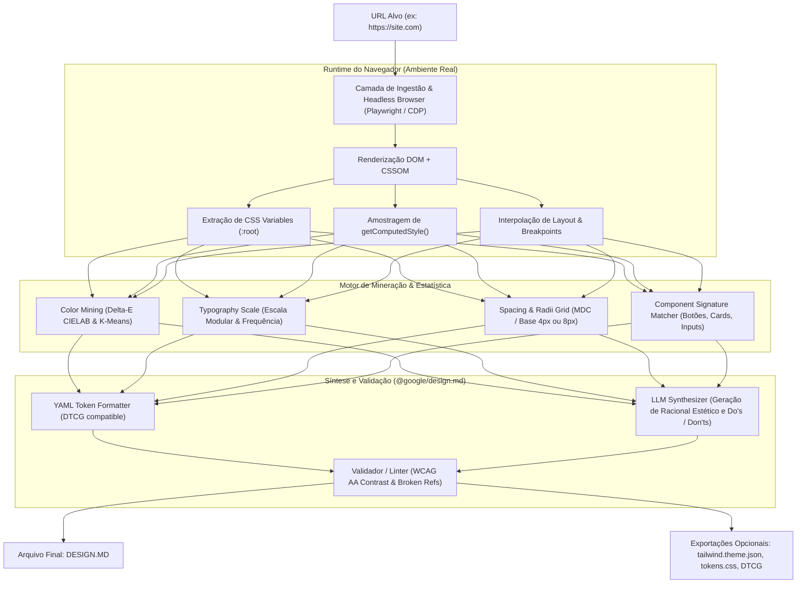

# Especificações Técnicas: Engenharia Reversa e Arquitetura do DesignMD (`designmd.co`)

> **Documento:** Especificação Arquitetural e Mapeamento de Extração de Design Systems para `DESIGN.MD`  
> **Referência Oficial:** Padrão Google Labs (`@google/design.md`) e Ferramentas de Extração (DesignMD, Dembrandt)  
> **Data de Análise:** Outubro de 2026  
> **Arquivo Alvo de Saída:** `DESIGN.MD`

---

## 1. Visão Geral e Contexto

O **`DESIGN.MD`** é uma especificação aberta criada e padronizada pelo **Google Labs** (`google-labs-code/design.md`) para fornecer a agentes de IA codificadores (como Claude Code, Cursor, Windsurf, GitHub Copilot, Codex e Antigravity) um entendimento persistente, estruturado e normativo da identidade visual e do design system de um projeto.

Assim como o `README.md` serve para humanos e o `AGENTS.md` define diretrizes operacionais de agentes, o `DESIGN.MD` funciona como o **"contrato visual e de marca"**. Ele elimina a chamada *"alucinação de design"* ou *design drift*, onde modelos de linguagem geram cores aleatórias, espaçamentos arbitrários e componentes despadronizados.

O ecossistema em torno do **DesignMD** (`designmd.co`, `mydesignmd.com`, `dembrandt`, etc.) automatizou o processo de **Engenharia Reversa de Design Systems da Web**:
1. O usuário submete a URL de qualquer site público (ex: Stripe, Linear, Vercel, Apple).
2. O motor analisa o DOM, CSSOM e estilos computados via navegador headless.
3. Agrupa e higieniza cores, tipografia, espaçamentos e raios de borda em tokens de design normalizados.
4. Detecta padrões semânticos de componentes (botões, cards, inputs).
5. Sintetiza a lógica estética em regras descritivas (prosa em Markdown) e valores normativos (YAML Front Matter / blocos YAML).
6. Gera o arquivo final `DESIGN.MD` estritamente compatível com o linter oficial `@google/design.md`.

---

## 2. Diagrama de Fluxo e Arquitetura do Pipeline



---

## 3. As 5 Fases do Pipeline de Extração e Transcrição

### Fase 1: Ingestão e Inspeção Headless (Playwright / CDP)

Para extrair o design real de uma página moderna (que usa React, Next.js, Vue, Tailwind ou CSS-in-JS), não basta baixar o HTML estático. É mandatório executar o JavaScript e renderizar o layout completo.

1. **Setup de Navegação Resiliente:**
   - Inicialização de uma instância Chromium via **Playwright** ou **Puppeteer**.
   - Definição de `User-Agent` moderno para contornar defesas anti-bot (como o Vercel Bot Mitigation observado no `designmd.co`).
   - Simulação de viewports responsivos: Desktop (`1440x900`) e Mobile (`390x844`).
   - Avaliação sob os modos `prefers-color-scheme: light` e `prefers-color-scheme: dark`.

2. **Trigger de Estados e Carregamento:**
   - `networkidle`: Aguarda a resolução das requisições assíncronas.
   - `scroll-down`: Realiza rolagem programática para forçar o disparo de *lazy loading* de imagens, tipografias e seções dinâmicas.

3. **Acesso às Folhas de Estilo (CSSOM):**
   - Leitura de `document.styleSheets`.
   - Extração de regras `:root`, `html`, e `body`.
   - Tratamento de folhas de estilo de terceiros (CORS): caso `sheet.cssRules` lance erro de segurança cross-origin, o pipeline usa interceptação de rede no nível CDP (`Network.getResponseBody`) para ler o CSS bruto.

---

### Fase 2: Mineração e Clusterização de Tokens de Design

Um site comum possui centenas de variações de cor e fontes ligeiramente divergentes criadas por múltiplos desenvolvedores. A inteligência do DesignMD está na **limpeza e clusterização estatística**:

#### A. Cores (Color Palette Mining)
- **Coleta:** Varrer `color`, `background-color`, `border-color`, `box-shadow`, `fill` e `stroke` de todos os nós visíveis (`node.checkVisibility() === true`).
- **Filtragem de Transparências:** Descartar `rgba(0,0,0,0)`, `transparent` e `inherit`.
- **Conversão de Espaço de Cor:** Converte tudo para HEX e espaço perceptivo **CIELAB / OKLCH**.
- **Clusterização Delta-E:** Agrupa cores cuja distância perceptual no espaço Lab ($\Delta E < 2.0$) seja imperceptível ao olho humano (ex: `#1a1a1a` e `#191919` são unificados).
- **Atribuição Semântica:**
  - `neutral`: Cores mais frequentes em fundos (`background-color` do `body` e contêineres principais).
  - `primary`: Cor de texto de títulos e elementos com maior peso hierárquico.
  - `secondary`: Cores de textos secundários, legendas e bordas neutras.
  - `tertiary` ou `accent`: Cor com maior saturação encontrada em botões primários e links (`<button>`, `<a>`, `.btn`).
  - `surface`: Cores de fundo de cards e modais que contrastam sutilmente com o fundo neutro.

#### B. Tipografia (Typography Hierarchy)
- **Extração por Elemento:** Coleta `font-family`, `font-size`, `font-weight`, `line-height` e `letter-spacing` para cada tag: `<h1>` a `<h6>`, `<p>`, `<span>`, `<button>`, `<a>`, `<label>`.
- **Frequência e Normalização:** Identifica a família principal de texto (*body*) e a família de títulos (*headings*).
- **Cálculo da Escala Modular:** Identifica o multiplicador geométrico entre tamanhos de fonte (ex: 1.250 - *Major Third*, 1.333 - *Perfect Fourth*):
  - `h1`: ~3rem (48px)
  - `h2`: ~2.25rem (36px)
  - `h3`: ~1.75rem (28px)
  - `body-md`: 1rem (16px)
  - `body-sm` / `label-caps`: 0.75rem - 0.875rem (12px - 14px)

#### C. Espaçamento e Grid (Spacing Scale)
- **Leitura de Medições:** Amostra `margin`, `padding`, `gap` e `grid-gap`.
- **Dedução da Unidade Base:** Determina o Máximo Divisor Comum (MDC) dos valores encontrados. Quase todas as marcas utilizam a escala baseada em **4px** ou **8px**:
  - `xs`: 4px
  - `sm`: 8px
  - `md`: 16px
  - `lg`: 24px
  - `xl`: 32px
  - `2xl`: 48px

#### D. Formas e Elevação (Rounded & Elevation)
- **Border Radius:** Mapeia os valores de `border-radius` mais comuns dos elementos clicáveis e contêineres:
  - `none`: `0px`
  - `sm`: `4px`
  - `md`: `8px`
  - `lg`: `12px` / `16px`
  - `full`: `9999px`
- **Box Shadows:** Identifica níveis de profundidade de sombras aplicadas a dropdowns, modais e cards (ex: `0 4px 6px -1px rgb(0 0 0 / 0.1)`).

---

### Fase 3: Detecção Semântica de Componentes

O extrator identifica classes de componentes-chave através de seletores semânticos e propriedades compostas:

```javascript
// Heurística de classificação de botões
const buttons = Array.from(document.querySelectorAll('button, a.btn, [role="button"]'));
const primaryButton = buttons.find(b => {
  const style = window.getComputedStyle(b);
  // O botão primário geralmente possui fundo saturado contrastante e texto claro
  return style.display !== 'none' && style.backgroundColor !== 'transparent';
});
```

Para cada componente detectado, gera o mapeamento:
- `backgroundColor`
- `textColor`
- `rounded` (referência a `{rounded.*}`)
- `padding`
- `fontSize` / `fontFamily`

---

### Fase 4: Garantia de Qualidade e Conformidade WCAG AA

O motor executa uma rotina de verificação contra as diretrizes de acessibilidade WCAG AA:
- **Cálculo de Razão de Contraste:**
  $$\text{Contrast Ratio} = \frac{L_1 + 0.05}{L_2 + 0.05}$$
  Onde $L_1$ é a luminância relativa da cor mais clara e $L_2$ da mais escura.
- Se o contraste entre `textColor` e `backgroundColor` de um botão ou texto de parágrafo for menor que **4.5:1** (ou **3:1** para textos grandes), o extrator ajusta ligeiramente a tonalidade ou emite um aviso no relatório técnico.

---

### Fase 5: Síntese LLM e Estruturação do `DESIGN.MD`

Uma vez colhidos os dados numéricos brutos em JSON, eles são estruturados em um prompt específico enviado a um modelo de linguagem (ex: Gemini 1.5/2.0, Claude 3.5 Sonnet) com as instruções do padrão Google Labs:

#### Prompt de Síntese Utilizado:
> *"Você é um Diretor de Design e Arquiteto de Sistemas. Com base no JSON de tokens brutos extraído do site [NOME], escreva um arquivo `DESIGN.MD` oficial. O arquivo deve iniciar obrigatoriamente com o bloco de YAML front matter (`---`) contendo as seções `name`, `colors`, `typography`, `rounded`, `spacing` e `components`. Abaixo do YAML, elabore a prosa em Markdown com a exata ordem canônica: `## Overview`, `## Colors`, `## Typography`, `## Layout`, `## Elevation & Depth`, `## Shapes`, `## Components`, `## Do's and Don'ts`. Explique o tom emocional da marca, a hierarquia de aplicação das cores e regras rígidas para agentes de IA."*

---

## 4. Script de Referência: Implementação do Extrator em Node.js / Playwright

Abaixo está o script completo e executável para extrair tokens e gerar o rascunho de `DESIGN.MD` a partir de qualquer URL:

```javascript
// extractor.mjs
import { chromium } from 'playwright';
import fs from 'fs';

export async function extractDesignTokens(targetUrl) {
  const browser = await chromium.launch({ headless: true });
  const context = await browser.newContext({
    viewport: { width: 1440, height: 900 },
    userAgent: 'Mozilla/5.0 (Windows NT 10.0; Win64; x64) AppleWebKit/537.36 (KHTML, like Gecko) Chrome/130.0.0.0 Safari/537.36'
  });

  const page = await context.newPage();
  await page.goto(targetUrl, { waitUntil: 'networkidle', timeout: 30000 });
  
  // Rolar para disparar renderização dinâmica
  await page.evaluate(() => window.scrollTo(0, document.body.scrollHeight / 2));
  await page.waitForTimeout(1000);

  const rawTokens = await page.evaluate(() => {
    // 1. Extrair variáveis CSS do :root
    const cssVars = {};
    for (const sheet of document.styleSheets) {
      try {
        for (const rule of sheet.cssRules) {
          if (rule.selectorText === ':root' || rule.selectorText === 'html') {
            const style = rule.style;
            for (let i = 0; i < style.length; i++) {
              const name = style[i];
              if (name.startsWith('--')) {
                cssVars[name] = style.getPropertyValue(name).trim();
              }
            }
          }
        }
      } catch (e) {
        // Ignora folhas com bloqueio CORS
      }
    }

    // 2. Coletar cores e fontes computadas
    const elements = Array.from(document.querySelectorAll('h1, h2, h3, p, button, a, [class*="card"], [class*="btn"]'));
    const colorCounts = {};
    const fontFamilies = new Set();
    const borderRadii = new Set();

    elements.forEach(el => {
      const style = window.getComputedStyle(el);
      if (style.display === 'none' || style.visibility === 'hidden') return;

      [style.color, style.backgroundColor].forEach(c => {
        if (c && !c.includes('rgba(0, 0, 0, 0)') && c !== 'transparent') {
          colorCounts[c] = (colorCounts[c] || 0) + 1;
        }
      });

      if (style.fontFamily) fontFamilies.add(style.fontFamily.split(',')[0].replace(/['"]/g, '').trim());
      if (style.borderRadius && style.borderRadius !== '0px') borderRadii.add(style.borderRadius);
    });

    // 3. Obter dados de Botão Primário
    const btn = document.querySelector('button, [role="button"], a.btn');
    let buttonToken = null;
    if (btn) {
      const bStyle = window.getComputedStyle(btn);
      buttonToken = {
        backgroundColor: bStyle.backgroundColor,
        textColor: bStyle.color,
        borderRadius: bStyle.borderRadius,
        padding: `${bStyle.paddingTop} ${bStyle.paddingRight}`,
        fontSize: bStyle.fontSize,
        fontWeight: bStyle.fontWeight
      };
    }

    return {
      cssVars,
      topColors: Object.entries(colorCounts).sort((a, b) => b[1] - a[1]).slice(0, 10).map(x => x[0]),
      fontFamilies: Array.from(fontFamilies).slice(0, 3),
      borderRadii: Array.from(borderRadii).slice(0, 4),
      buttonToken
    };
  });

  await browser.close();
  return rawTokens;
}
```

---

## 5. Especificação Canônica do `DESIGN.MD` (Padrão Google Labs)

Todo arquivo `DESIGN.MD` gerado deve respeitar a ordem canônica das seções e a sintaxe de referências `{colors.primary}` para validação via CLI `npx @google/design.md lint DESIGN.md`.

### Template Oficial Padrão

```md
---
name: Design System Extraído
version: alpha
colors:
  primary: "#0F172A"       # Texto principal / Títulos
  secondary: "#475569"     # Texto secundário e bordas suaves
  tertiary: "#2563EB"      # Cor de destaque / Ação primária (CTA)
  neutral: "#FFFFFF"       # Fundo da aplicação
  surface: "#F8FAFC"       # Fundo de cards e superfícies elevadas
  on-tertiary: "#FFFFFF"   # Cor do texto sobre o fundo tertiary
typography:
  fontFamily: "Inter, -apple-system, sans-serif"
  h1:
    fontFamily: "{typography.fontFamily}"
    fontSize: 2.5rem
    fontWeight: 700
    lineHeight: 1.2
  h2:
    fontFamily: "{typography.fontFamily}"
    fontSize: 2rem
    fontWeight: 600
    lineHeight: 1.25
  body-md:
    fontFamily: "{typography.fontFamily}"
    fontSize: 1rem
    fontWeight: 400
    lineHeight: 1.5
  label-caps:
    fontFamily: "{typography.fontFamily}"
    fontSize: 0.75rem
    fontWeight: 600
    letterSpacing: "0.05em"
rounded:
  sm: 4px
  md: 8px
  lg: 16px
  full: 9999px
spacing:
  xs: 4px
  sm: 8px
  md: 16px
  lg: 24px
  xl: 32px
components:
  button-primary:
    backgroundColor: "{colors.tertiary}"
    textColor: "{colors.on-tertiary}"
    rounded: "{rounded.md}"
    padding: "10px 16px"
    fontSize: "{typography.body-md.fontSize}"
  card:
    backgroundColor: "{colors.surface}"
    rounded: "{rounded.lg}"
    padding: "{spacing.lg}"
    border: "1px solid {colors.secondary}"
---

## Overview

Este sistema de design foi extraído para guiar agentes de IA na geração de interfaces consistentes, elegantes e modernas. A estética combina minimalismo corporativo de alta tecnologia com legibilidade impecável e contraste acessível.

## Colors

A paleta de cores é estruturada em torno de contrastes nítidos e um ponto focal vibrante:
- **Primary (`#0F172A`):** Tonalidade ardósia profunda reservada a títulos e textos de alta ênfase.
- **Secondary (`#475569`):** Cinza neutro para metadados, legendas e bordas sutis.
- **Tertiary (`#2563EB`):** Azul cobalto destinado a gatilhos de interação, botões de ação e links ativos.
- **Neutral (`#FFFFFF`):** Base da aplicação, promovendo respiro visual.
- **Surface (`#F8FAFC`):** Plano de fundo para cards, modais e elementos destacados da superfície principal.

## Typography

Utiliza uma tipografia neo-grotesca limpa (`Inter`), focada em clareza técnica e densidade equilibrada.
- **Headings (H1/H2):** Pesos 600/700 com entrelinha compacta para impacto visual imediato.
- **Body (`body-md`):** Peso 400 com entrelinha 1.5 para conforto de leitura em textos longos.
- **Labels (`label-caps`):** Caixa-alta com espaçamento ampliado (`letter-spacing: 0.05em`) para tags e status.

## Layout

O grid opera estritamente na escala de múltiplos de **4px/8px**:
- Espaçamento padrão entre blocos: `{spacing.xl}` (32px).
- Respiro interno de componentes: `{spacing.md}` (16px).
- Alinhamento de contêineres: Centralizados com largura máxima de 1280px e padding lateral responsivo de 16px a 32px.

## Elevation & Depth

- **Nível 1 (Cards):** Bordas sólidas finas (`1px solid {colors.secondary}`) com elevação sutil: `box-shadow: 0 1px 3px 0 rgb(0 0 0 / 0.1)`.
- **Nível 2 (Dropdowns e Menus):** Sombra projetada média: `box-shadow: 0 10px 15px -3px rgb(0 0 0 / 0.1)`.
- **Nível 3 (Modais):** Fundo com backdrop blur e sombra acentuada: `box-shadow: 0 20px 25px -5px rgb(0 0 0 / 0.1)`.

## Shapes

- Os elementos interativos utilizam cantos arredondados contidos (`{rounded.md}` = 8px).
- Badges e avatares adotam cantos totalmente circulares (`{rounded.full}`).
- Evite cantos totalmente pontiagudos (`0px`), mantendo a suavidade da interface.

## Components

### Botão Primário (`button-primary`)
- Fundo em `{colors.tertiary}` com texto em `{colors.on-tertiary}`.
- O raio do contorno deve usar `{rounded.md}`.
- Transições ativas: feedback visual no hover com redução suave de luminosidade (90%).

### Cards (`card`)
- Fundo em `{colors.surface}` cercado por borda suave.
- Padding interno fixado em `{spacing.lg}`.

## Do's and Don'ts

### Do's:
- **Use tokens semânticos:** Sempre faça referência a `{colors.tertiary}` em vez de valores HEX soltos nos componentes.
- **Mantenha contraste mínimo:** Certifique-se de que textos sobre fundos coloridos respeitem o limite WCAG AA (mínimo 4.5:1).
- **Consistência de espaçamento:** Aplique apenas valores contidos na escala `spacing` (`4px`, `8px`, `16px`, `24px`, `32px`).

### Don'ts:
- **Não crie novas cores primárias:** Toda nova interface gerada por IA deve reutilizar a paleta declarada.
- **Não misture estilos de cantos:** Nunca aplique botões com 16px de raio junto a inputs de 2px.
- **Não use sombras excessivas:** O estilo prescrito prioriza bordas finas sobre sombras pesadas.
```

---

## 6. Integração com a CLI Oficial `@google/design.md`

Uma vez gerado o arquivo `DESIGN.MD`, os comandos oficiais permitem validação e exportação para ecossistemas modernos:

```bash
# 1. Validação estrutural, detecção de referências quebradas e contraste WCAG AA
npx @google/design.md lint DESIGN.md

# 2. Exportação direta para Tailwind CSS v4 (@theme CSS variables)
npx @google/design.md export --format css-tailwind DESIGN.md > theme.css

# 3. Exportação para Tailwind CSS v3 (JavaScript JSON config)
npx @google/design.md export --format json-tailwind DESIGN.md > tailwind.theme.json

# 4. Exportação para o padrão mundial DTCG (Design Tokens Community Group)
npx @google/design.md export --format dtcg DESIGN.md > tokens.json
```

---

## 7. Mapeamento com Ferramentas Locais (REA / Antigravity)

Para equipes trabalhando com o **REA (Reverse Engineer Anything)** configurado no workspace:
- O REA pode ser utilizado para inspecionar pacotes Web e aplicações Electron através de `npm run rea -- analyze-web-bundle <dir>` ou `inspect-web-page` via CDP.
- O pipeline acima conecta as duas pontas: a extração de runtime web (Playwright / CDP) gera o `DESIGN.MD`, que em seguida alimenta o contexto do agente de IA (Antigravity, Cursor, Claude Code), assegurando que o código gerado esteja 100% alinhado com o design system do site analisado.
